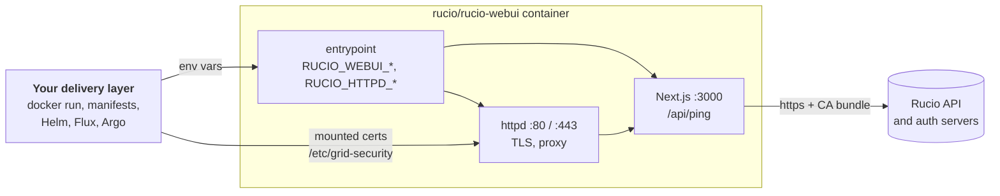

# How to get started
Deploying the WebUI for your community

<!--
Third part, for communities deploying the WebUI for the first time, or moving off the old UI.
-->

---
layout: default
---

# Everything is an environment variable



<div class="grid grid-cols-3 gap-4 mt-2 text-sm">
  <div class="bg-neutral-100 dark:bg-neutral-800 rounded-lg p-3"><code>RUCIO_WEBUI_*</code> configures the WebUI; the prefix is stripped</div>
  <div class="bg-neutral-100 dark:bg-neutral-800 rounded-lg p-3">Certificates are files you mount: host cert and key, CA bundle, CA directory</div>
  <div class="bg-neutral-100 dark:bg-neutral-800 rounded-lg p-3">How they reach the container is up to you</div>
</div>

<!--
The one idea to take home: the image has no community-specific content. All configuration is environment variables; certificates are mounted files.
The WebUI reads the RUCIO_WEBUI_ variables; httpd reads RUCIO_HTTPD_ ones plus RUCIO_WEBUI_ENABLE_SSL and RUCIO_WEBUI_HOSTNAME.
Whether you use docker run, plain manifests, Helm, Flux with SOPS like ATLAS, or Argo with external secrets does not matter to the container.
-->

---
layout: default
---

# Step 0: the Rucio servers

<div class="grid grid-cols-2 gap-6 mt-4">

<div>

**CORS**: list the WebUI origin on **both** the API and the auth server

```ini
# rucio.cfg
[webui]
urls = https://rucio-ui.example.org
```

```bash
# or in the rucio server container
RUCIO_CFG_WEBUI_URLS=https://rucio-ui.example.org
```

<p class="text-xs">Missing origin: the preflight is refused and login fails in the browser</p>

</div>

<div>

**For OIDC**: the auth server knows your IdP

```ini
[oidc]
idpsecrets = /opt/rucio/etc/idpsecrets.json
expected_audience = rucio
```

Map each person to an account, from the CLI or from the new account page

```bash
rucio account identity add jdoe --type OIDC \
  --id "SUB=<sub>, ISS=<issuer>" --email jdoe@example.org
```

</div>

</div>

<!--
Do this first, because most "the WebUI does not work" reports are actually CORS.
The browser talks to the auth server directly for x509 login, so the auth server needs the WebUI origin too.
For OIDC the auth server needs the IdP secrets and the expected audience; then every user's OIDC identity is mapped to a Rucio account. Admins can now do that from the Identities tab in the WebUI.
-->

---
layout: default
---

# Hello world

```bash
docker run -d --name rucio-webui -p 80:80 \
  -e RUCIO_WEBUI_RUCIO_HOST=https://rucio.example.org \
  -e RUCIO_WEBUI_RUCIO_AUTH_HOST=https://rucio-auth.example.org \
  -e RUCIO_WEBUI_HOSTNAME=localhost \
  -e RUCIO_WEBUI_NEXTAUTH_URL=http://localhost \
  -e RUCIO_WEBUI_NEXTAUTH_SECRET="$(openssl rand -base64 32)" \
  -e RUCIO_WEBUI_PROJECT_URL=https://example.org \
  -e RUCIO_WEBUI_VO_DEF_NAME=default \
  -e RUCIO_WEBUI_SERVER_CA_BUNDLE=/etc/grid-security/ca.pem \
  -e NODE_EXTRA_CA_CERTS=/etc/grid-security/ca.pem \
  -v $PWD/ca.pem:/etc/grid-security/ca.pem:ro \
  rucio/rucio-webui:release-41.1.0

curl -s localhost/api/ping     # {"status":"ok","version":"41.1.0"}
```

<div class="grid grid-cols-3 gap-4 mt-2 text-sm">
  <div class="bg-neutral-100 dark:bg-neutral-800 rounded-lg p-3">Userpass and x509 login are on by default</div>
  <div class="bg-neutral-100 dark:bg-neutral-800 rounded-lg p-3"><code>ca.pem</code> must verify your Rucio servers</div>
  <div class="bg-neutral-100 dark:bg-neutral-800 rounded-lg p-3">Set <code>NEXTAUTH_SECRET</code> yourself, or sessions end on every restart</div>
</div>

<!--
The smallest working deployment on 41.1.0: two Rucio hosts, where the WebUI lives, a session secret, a project link, a name for the default VO, and the CA bundle.
NODE_EXTRA_CA_CERTS is needed on 41.x only; the next image sets it from SERVER_CA_BUNDLE.
Note the secret: last year's slide said AUTH_SECRET, but 41.x reads NEXTAUTH_SECRET. Without it, every boot picks a random secret and every replica a different one.
/api/ping is the health check: it answers with the version.
-->

---
layout: default
class: code-xs
---

# Add what you need

<div class="grid grid-cols-3 gap-4 mt-2">

<div>

**TLS in the container**

```bash
-p 443:443
-e RUCIO_WEBUI_ENABLE_SSL=True
-e RUCIO_WEBUI_HOSTNAME=\
   rucio-ui.example.org
-e RUCIO_WEBUI_NEXTAUTH_URL=\
   https://rucio-ui.example.org
-v hostcert.pem:\
   /etc/grid-security/hostcert.pem
-v hostkey.pem:\
   /etc/grid-security/hostkey.pem
```

</div>

<div>

**x509 login**

```bash
-e RUCIO_WEBUI_X509_ENABLED=true
-e RUCIO_CA_PATH=\
   /etc/grid-security/certificates
-v /etc/grid-security/certificates:\
   /etc/grid-security/certificates
```

<p class="text-xs">The browser sends the user certificate to the <strong>auth server</strong>, so its CORS and CA setup matter most</p>

**Userpass off**

```bash
-e RUCIO_WEBUI_ENABLE_USERPASS_LOGIN=\
   false
```

</div>

<div>

**OIDC**

```bash
-e RUCIO_WEBUI_OIDC_ENABLED=true
-e RUCIO_WEBUI_OIDC_PROVIDERS=cern
# per provider, prefixed with
# RUCIO_WEBUI_OIDC_PROVIDER_CERN_:
#   CLIENT_ID, CLIENT_SECRET,
#   AUTHORIZATION_URL, TOKEN_URL,
#   USERINFO_URL, ISSUER, SCOPES,
#   REDIRECT_URL, ICON_URL
```

<p class="text-xs">Register <code>https://&lt;host&gt;/api/auth/callback/cern</code> with your IdP</p>

**Multi-VO**

```bash
-e RUCIO_WEBUI_MULTIVO_ENABLED=true
-e RUCIO_WEBUI_VO_LIST=def,atl
-e RUCIO_WEBUI_VO_ATL_NAME=ATLAS
```

</div>

</div>

<!--
Each feature is a few more variables on top of hello world.
TLS: httpd terminates TLS with the mounted host cert and key. Write True with a capital T: httpd compares it exactly.
x509: mount the IGTF CA directory and point RUCIO_CA_PATH at it.
OIDC: one block of variables per provider; the redirect URL is the WebUI's callback for that provider name.
Multi-VO: a VO list, and a name, logo and OIDC providers per VO.
-->

---
layout: default
---

# Shape the UI with flags

```bash
# Accounts come from CRIC or IAM: keep the pages, no writes
-e RUCIO_WEBUI_FEATURE_ACCOUNTS_MANAGE=false
# No rule approval workflow in this community
-e RUCIO_WEBUI_FEATURE_RULES_APPROVE=false
# Opt-in integrations
-e RUCIO_WEBUI_FEATURE_DDM_DASHBOARD=true
-e RUCIO_WEBUI_DDM_DASHBOARD_BASE_URL="https://grafana.example.org/d/<id>/<slug>?orgId=1"
-e RUCIO_WEBUI_FEATURE_DIDS_PANDA_TASK=true      # ATLAS
-e RUCIO_WEBUI_FEATURE_DIDS_AMI_TAGS=true        # ATLAS, needs the CERN Grid CA in the bundle
```

<div class="grid grid-cols-3 gap-4 mt-4 text-sm">
  <div class="bg-neutral-100 dark:bg-neutral-800 rounded-lg p-3">Unset means the core default: <strong>on</strong></div>
  <div class="bg-neutral-100 dark:bg-neutral-800 rounded-lg p-3">A parent switched off wins over its children</div>
  <div class="bg-neutral-100 dark:bg-neutral-800 rounded-lg p-3">Disabled pages and APIs answer 404</div>
</div>

<!--
Most communities change nothing here. Flags are for removing what does not fit your community, and for opting in to integrations.
The full flag list is in the appendix.
-->

---
layout: default
class: code-xs
---

# The same thing as Helm values

<div class="grid grid-cols-5 gap-6">

<div class="col-span-3">

```yaml
image: { repository: rucio/rucio-webui, tag: release-41.1.0 }
useSSL: true                     # RUCIO_WEBUI_ENABLE_SSL=True, port 443
tlsSecretName: rucio-ui-tls      # mounted as hostcert.pem / hostkey.pem
secretMounts:
  - secretFullName: rucio-ui-ca
    mountPath: /etc/grid-security/ca.pem
    subPath: ca.pem
config:
  webui:                         # each key becomes RUCIO_WEBUI_<KEY>
    rucio_host: "https://rucio.example.org"
    rucio_auth_host: "https://rucio-auth.example.org"
    hostname: "rucio-ui.example.org"
    nextauth_url: "https://rucio-ui.example.org"
    server_ca_bundle: "/etc/grid-security/ca.pem"
    oidc_enabled: "True"
    oidc_providers: "cern"
  oidc_providers:                # RUCIO_WEBUI_OIDC_PROVIDER_<NAME>_<KEY>
    cern: { issuer: "...", authorization_url: "...", token_url: "..." }
optionalConfig:
  NODE_EXTRA_CA_CERTS: /etc/grid-security/ca.pem
additionalEnvs:                  # secrets stay in Secrets
  - name: RUCIO_WEBUI_NEXTAUTH_SECRET
    valueFrom:
      secretKeyRef: { name: rucio-ui-auth, key: nextauth-secret }
```

</div>

<div class="col-span-2 text-sm">

- Chart: `rucio-webui` from `rucio/helm-charts`
- Always set `image.tag`: the chart default is still `release-33.0.0`
- `config.vo.<vo>.<key>` for VOs, `config.httpd.<key>` for httpd
- `additionalEnvs` takes any Kubernetes `env` entry, so client secrets come from Secrets too

<div class="bg-neutral-100 dark:bg-neutral-800 rounded-lg p-3 mt-4 text-xs">
  <strong>ATLAS</strong> runs exactly this through a Flux <code>HelmRelease</code>, with SOPS-encrypted Secrets fed in through <code>valuesFrom</code>
</div>

</div>

</div>

<!--
The Helm chart is only a mapping from values to the same environment variables.
config.webui keys become RUCIO_WEBUI_ variables, oidc_providers become per-provider variables, vo becomes per-VO variables.
Secrets go through additionalEnvs with secretKeyRef, so they never sit in the values file.
Flux and Argo add nothing new on top: they deliver these values and the secrets.
-->

---
layout: default
---

# Three ways to run it

<div class="grid grid-cols-3 gap-4 mt-4">

<div class="border-2 border-brand-500 rounded-xl p-4">
  <div class="font-semibold text-neutral-900 dark:text-neutral-100 mb-2">TLS in the container</div>
  <p class="text-sm !leading-snug">httpd terminates TLS with your host certificate. A LoadBalancer on 443 in front.</p>
  <p class="text-xs !mb-0 opacity-75">How ATLAS runs it</p>
</div>

<div class="bg-neutral-100 dark:bg-neutral-800 rounded-xl p-4">
  <div class="font-semibold text-neutral-900 dark:text-neutral-100 mb-2">TLS at the ingress</div>
  <p class="text-sm !leading-snug">Your ingress or load balancer terminates TLS; httpd listens on 80. Set <code>NEXTAUTH_URL</code> to the public <code>https://</code> URL.</p>
</div>

<div class="bg-neutral-100 dark:bg-neutral-800 rounded-xl p-4">
  <div class="font-semibold text-neutral-900 dark:text-neutral-100 mb-2">No httpd</div>
  <p class="text-sm !leading-snug">Run <code>next start</code> on port 3000 behind any proxy or tunnel, with the unprefixed variable names.</p>
  <p class="text-xs !mb-0 opacity-75">How our demo instance runs</p>
</div>

</div>

<div class="mt-6 border-2 border-dashed border-neutral-400 rounded-xl p-4">
  <div class="font-semibold text-neutral-900 dark:text-neutral-100 mb-1">With the next release</div>
  <p class="text-sm !mb-0">Hello world drops to <strong>5 variables and one CA file</strong>: <code>NEXTAUTH_URL</code> comes from <code>HOSTNAME</code>, the CA variable is exported for you, and the container starts in seconds because it no longer builds at boot.</p>
</div>

<!--
All three are real deployments today.
The first is ATLAS. The second is common on Kubernetes clusters with an ingress controller. The third is how the demo instance on beast runs, behind a Cloudflare tunnel.
After the three PRs land, PROJECT_URL and the VO name get defaults, NEXTAUTH_URL is derived, and NODE_EXTRA_CA_CERTS is set from SERVER_CA_BUNDLE.
-->

---
layout: default
class: table-compact
---

# When something is wrong

| Symptom | Check |
|---|---|
| Login fails with a CORS error in the browser console | WebUI origin in `[webui] urls` on the auth **and** API server |
| Logged out after every restart, or on another replica | `RUCIO_WEBUI_NEXTAUTH_SECRET` from a Secret, the same on every replica |
| `fetch failed` or certificate errors to Rucio | The CA bundle verifies both servers (and AMI, if enabled) |
| OIDC login ends with "no account" | The identity is mapped: `SUB=..., ISS=...` on the right account |
| A page answers 404 | A feature flag, or one of its parents, is off |
| Slow start, memory spike at boot | Expected on 41.x: the image builds at start. Fixed in the next release |

<div class="text-sm mt-4">

Start with `curl https://<host>/api/ping`. Then ask in the **Rucio WebUI** channel on Mattermost.

</div>

<!--
The six problems we see most often when communities set up the WebUI.
-->
