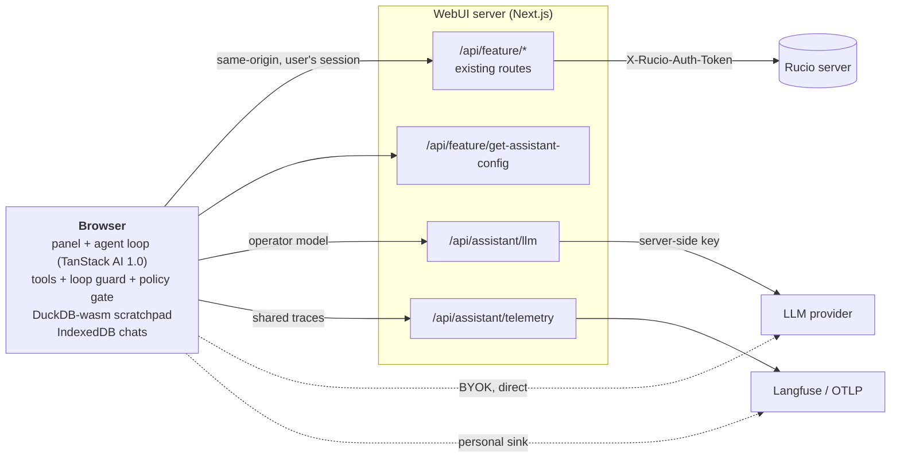
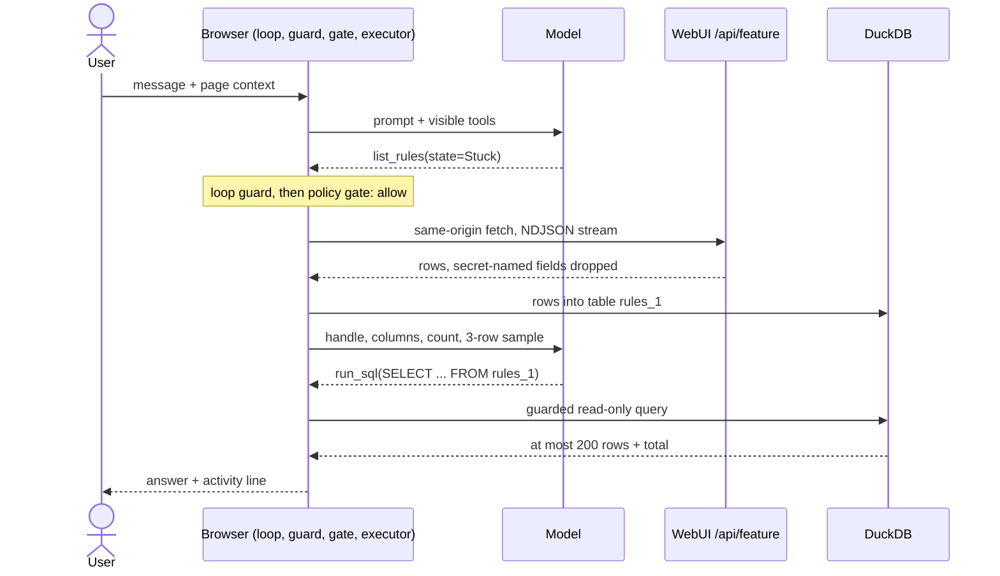
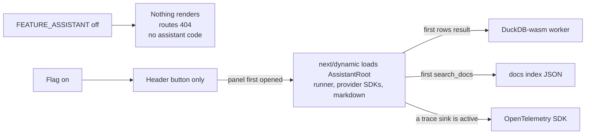

# Architecture: the agent runs in the browser

  
<strong>Server adds only</strong> the LLM relay, the telemetry relay and the config route

  
<strong>Tools</strong> call the WebUI's own <code>/api/feature</code> routes, so the bot sees exactly what the user can see

  
<strong>Why the browser:</strong> reach a local Ollama, user base URLs never touch our server (no SSRF), approvals live where tools run

<!--
The key design decision: the agent loop runs in the browser, on TanStack AI 1.0, pinned exactly.
Only two files import TanStack: tanstack-agent-runner.ts and tanstack-tools.ts, so the framework is swappable.
The server gains three things: the operator LLM relay, the telemetry relay, and get-assistant-config, which returns the operator settings without any secrets.
Tools are plain same-origin fetches to the routes the WebUI already has. The server attaches the Rucio token as it always does; Rucio authorizes every call.
Personal providers and personal trace sinks are called straight from the browser, so a user's base URL is never fetched by our server.
-->

---
layout: default
---

# One turn

  Ends when the model finishes, Stop is pressed, the tool budget runs out or the 25-step limit is hit (then <strong>Continue</strong>).

<!--
Walk through one turn.
The user message carries a page context block unless the user removes the chip.
The model only sees tools that are visible for this user and starts with a small always-on set; find_tools loads domain tools on demand, which keeps prompts small for local models.
Every call goes through the loop guard and the policy gate first.
Row results never go back to the model: they become a DuckDB table, and the model gets the handle name, columns, row count and a three row sample. Then it writes SQL.
-->

---
layout: default
---

# One turn, as the user sees it

  
  
Answer with its activity line expanded

  
  
<code>find_tools</code> loads the rule tools, then <code>list_rules</code> runs; arguments and results stay inspectable

<!--
The same turn in the UI. The collapsed line reads: thought 4 seconds, tools, query, tokens, cost.
Expanded, you see the model's reasoning when the provider exposes it, then every tool call with arguments and result.
find_tools is how the model loads domain tools on demand: it starts with a small always-on set.
-->

---
layout: default
---

# Hexagonal layers

| Layer | Rucio bot pieces |
|---|---|
| Entities <code>core/entity/assistant/</code> | tool, conversation, data-handle, skill, settings, usage, page-context, events |
| Ports <code>core/port/secondary/</code> | conversation repository, data handle store, knowledge index, skill source, page action registry, config gateway |
| Services <code>core/services/</code> | <code>assistant-policy</code>, <code>assistant-sql-guard</code>, <code>assistant-retention</code>, <code>assistant-secret-keys</code>, tool search |
| Use cases | <code>get-assistant-config</code>, <code>list-requests</code> (controller and presenter, like every route) |
| Infrastructure <code>infrastructure/assistant/</code> | runner, tool registry, feature executor, DuckDB store, IndexedDB repository, telemetry, relays |
| Component library <code>features/assistant/</code> | Panel, ApprovalCard, ActivityTimeline, ResultTable, ContextGauge, settings tabs |

<!--
It follows the WebUI's hexagonal architecture, so nothing here should surprise a WebUI contributor.
The policy, the SQL guard, retention and the secret field rule are pure functions in core services, which made them easy to test exhaustively.
Infrastructure holds the adapters: TanStack runner, DuckDB, IndexedDB, OpenTelemetry.
The component library holds presentational components with Storybook stories.
-->

---
layout: default
---

# Lazy by design: zero cost with the flag off

  
<code>AssistantMount</code> renders nothing until the panel is opened once, then stays mounted to keep the chat across navigation

  
Build check: entry chunks of <code>/dashboard</code>, <code>/rules</code> and <code>/rule/create</code> carry no DuckDB, TanStack AI, OpenTelemetry or MiniSearch code

<!--
We were careful about bundle cost. Users who never open the panel pay nothing.
The DuckDB wasm files are about 8 MB gzipped each, so they only load when the first list result arrives.
We checked the production build output after each merge: the page entry chunks contain none of these libraries; they only exist in lazy chunks.
-->
