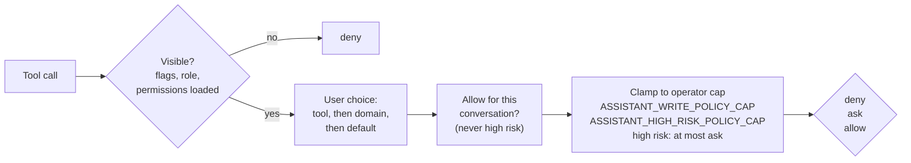

# Permissions: deny, ask, allow per tool

  
<strong>Reads</strong> default to allow

  
<strong>Writes</strong> default to ask

  
<strong>High risk</strong> always ask, never allow

  Operators cap, users can only tighten. Computed live on <strong>every</strong> call: a lowered cap or a tightened choice applies mid-turn. While the operator config is loading or failed, writes fail closed.

<!--
The policy is a pure function, effectivePolicy, in core services.
Hidden tools are never offered, and denied if named anyway.
Then the user's choice for that tool, or for its domain, or the default for its risk.
"Allow for this conversation" on an approval card upgrades ask to allow for the rest of the chat, but never for high risk.
Then the operator cap clamps it, and high risk tools are clamped to ask on top, so even an operator cannot set them to allow in v1.
It is evaluated on every single tool call, not cached, so tightening something mid-turn is honoured on the next call.
Unknown or tampered values count as deny.
-->

---
layout: default
---

# High-risk tools always ask

<code>update_rule</code> (approve or deny rules) 
<code>declare_bad_replicas</code> 
<code>update_account</code> (suspend, reactivate) 
<code>delete_account</code> 
<code>add_account_attribute</code> 
<code>update_account_attribute</code> 
<code>delete_account_attribute</code> 
<code>add_account_identity</code> 
<code>delete_account_identity</code>

The other 7 write tools (create_rule, set_account_limit, ...) default to ask. Account writes are admin only; <code>declare_bad_replicas</code> also needs its own flag.

  
  
Red card, no "Allow for this conversation"

<!--
Nine tools are high risk. The rule of thumb: anything that can lock someone out, grant admin, approve someone else's request, or lose the last copy of data.
Adding or updating an account attribute is high risk because admin=True makes the account a Rucio admin.
The high-risk card is red and never offers the conversation-wide allow.
-->

---
layout: default
---

# Approval cards

  
  
One-line summary, why it asks, optional "Allow for this conversation"

  
  
Invalid arguments from the model: Reject only

  
  
Chat closed before a decision: expired, it did not run

- Raw arguments behind **Show arguments**, passwords masked; Approve comes first and is full width on mobile
- The decision is **saved before the runner resumes**; a stale or late click never resumes it
- After a reload, an approved call that never reported back reads "may have been applied"

<!--
The card is designed to be read in two seconds: one line saying what will happen, and why we are asking.
If the model sends arguments that fail the route schema, nothing can be approved; you can only reject.
Decisions are persisted before the runner continues, so a crash or reload can never turn a pending call into an executed one, and we never claim a write did not land when it might have.
-->

---
layout: default
---

# The Permissions settings tab

- Tools grouped by domain: DIDs, Rules, RSEs, Accounts, Replicas, Subscriptions, Requests
- deny / ask / allow per tool and per domain
- Options above the operator cap are disabled with an **Operator limit** hint
- High-risk tools show a **High risk** badge and no Allow option
- Hidden tools are listed with the reason: Feature off, Admin only, Write tools are off
- Reset to defaults
- One of six tabs at <code>/assistant/settings</code>: Providers, Permissions, Skills, Telemetry, Display, Storage

  

<!--
Users manage this in the Permissions tab of the Rucio bot settings page.
A cautious user can set reads to ask, or deny a whole domain. A power user can allow create_rule without asking, if the operator cap allows it.
Everything above the operator cap is visibly disabled, so nobody is confused about why "allow" does nothing.
-->
