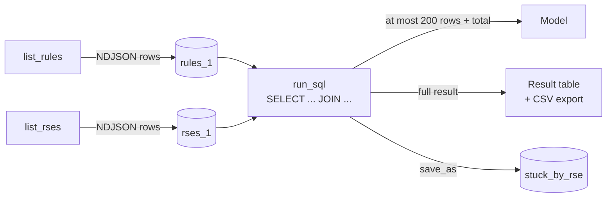

# SQL scratchpad: DuckDB-wasm in the browser

- <code>@duckdb/duckdb-wasm</code> 1.32.0 (1.4 LTS) in a Web Worker
- **Self-hosted** under <code>/duckdb</code>: no CDN, air-gapped deployments work
- **Locked down:** external access off, no extension install or autoload, then <code>lock_configuration</code>, so no file, URL or extension access

- A guard accepts one <code>SELECT</code> or <code>WITH</code> statement only
- Up to 50,000 rows per call (10,000 on 4 GB devices), flagged <code>truncated</code>
- **Stop** terminates a runaway query; idle workers stop after 10 minutes

<!--
This is the piece people like most. Large results never go into the prompt.
Each list tool call streams its rows into a DuckDB table with a handle name like rules_1, and the model writes SQL across handles, including joins.
The model gets at most 200 rows back, the user gets the full table with CSV export, and save_as keeps a result as a new handle.
It is locked down twice: a parser-level guard that only accepts a single SELECT or WITH, and DuckDB settings that disable external access and lock the configuration.
-->

---
layout: default
---

# Data handles: refresh instead of storing rows

- **The model gets** a handle name, columns, row count, <code>truncated</code> and a 3-row sample, never the rows
- **Stored** is only provenance: tool name, arguments, fetch time. Rows never reach IndexedDB
- **Coming back later**, handles show as expired; <code>refresh_handle</code> or **Refresh** re-runs the source read under your current permissions
- Tables are dropped on new chat, chat switch and account switch; the Storage tab shows DuckDB memory and **Free memory now**
- Known limit: joins need compatible keys; RSE expressions are resolved with <code>list_rses</code> first

  
  

<!--
Data tables are ephemeral by design. Storing Rucio rows in the browser forever would be a privacy and staleness problem.
Instead we store where each table came from, and a refresh re-runs that read, still subject to the user's tool permissions and current session.
-->

---
layout: default
---

# Runtime: loop guard, step limit, compaction

  
Loop guard (per turn)

- Tool budget <code>ASSISTANT_MAX_TOOL_CALLS</code> (default 20, parallel calls count)
- An identical call that already failed is refused; timeouts and network errors get one retry
- After 3 failures in a row the model is told to stop and explain
- 25 model steps per turn, then a **Continue** button with a fresh budget

  
Context and cost

- Above **70%** of the context window older turns are summarised; the last 4 stay verbatim; the visible transcript does not change
- A context overflow compacts and retries once
- Context gauge in the header: <code>41% of 200k</code>
- Activity line per answer: <code>Thought 4s · 3 tools · 1 query · 12.4k / 0.8k tok · $0.04</code>

<!--
Agents loop. Small local models especially can call the same failing tool forever.
The guard counts every call against a per-turn budget, refuses an exact repeat of a failed call, and after three failures in a row tells the model to stop and explain.
Compaction keeps long chats inside the context window with one extra model call; the user still sees the full transcript.
Tokens and cost are tracked per turn and per conversation from the model catalog prices; unknown models show no price rather than a wrong one.
-->

---
layout: default
---

# Step limit, Continue and the context gauge

  

- The turn hit its limit, so the panel says so and offers **Continue**, which starts a fresh step and tool budget
- Header gauge: <code>41% of 200.0k</code> of the model's context window; above 70% older turns are compacted
- Collapsed activity line with time, tools, tokens and cost:

<!--
What the user sees when the loop guard or the step limit ends a turn: a plain notice and a Continue button. Nothing is lost; the next turn starts with a fresh budget.
The gauge in the header tracks the prompt size against the model's context window.
-->
