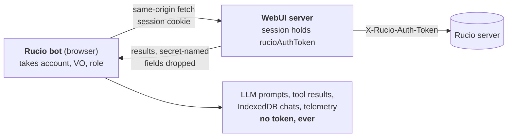

# Security: the Rucio token never reaches the chat

  
Tools never handle credentials: requests are same-origin and the server attaches the token as for any page

  
Secret-named fields (token, password, secret, apikey, cookie, session, authorization) are dropped from every row and object result before the model or DuckDB sees them

  
Page context takes primitives only and drops token-like URL params; traces are scrubbed before export

<!--
The question everyone asks first: can the model see my Rucio token? No.
Tools are same-origin fetches. The browser sends the session cookie, the WebUI server looks up the session and sends X-Rucio-Auth-Token to Rucio, exactly like for any page.
The assistant code takes only account, VO and role from the session. The token field is never read.
On top of that, defence in depth: secret-named fields are removed from every tool result, the page context builder only accepts primitives and drops params like token, code or key, and every telemetry span goes through a scrubber.
-->

---
layout: default
---

# Prompt injection and exfiltration

  
Untrusted data blocks

  
Tool results, <code>&lt;page_context&gt;</code> and <code>&lt;conversation_summary&gt;</code> are data, never instructions. Closing tags hidden in page text are neutralised, also full-width, zero-width and entity variants.

  
Policy lives in code

  
Permissions live in code. Nothing in a DID comment, a skill or a doc can raise them; a write still needs your click.

  
No zero-click exfiltration

  
Markdown images render as plain links, <code>img</code> is not an allowed element and raw HTML is never rendered. A model cannot make the browser fetch <code>evil.example/?data=...</code> on render.

  
Links and navigation

  
Relative links stay in the app, anything else opens a new tab (<code>noopener</code>). <code>navigate</code> only pushes plain in-app paths built by our URL builders: no dot segments, no <code>/auth</code> or <code>/api</code>.

<!--
Rucio data is user-generated: DID names, metadata, rule comments. Any of it can contain text that tries to steer the model.
We treat all of it as data, and the system prompt says so. The data blocks cannot be closed early from page text, even with Unicode tricks.
More important: the policy is enforced in code, so a successful injection still cannot run a write without the user's approval.
The classic exfiltration trick is a markdown image whose URL carries data. Images never load; they render as links you would have to click.
-->

---
layout: default
---

# Session and account safety

### Session gate

- Session expired or signed out: the panel is **covered and disabled**
- A running turn stops like Stop; new sends are refused
- Only the live turn may navigate or minimise the panel
- A login redirect during a tool call becomes <code>session_expired</code> and one banner

### Bound to the account

- Approved writes carry <code>x-rucio-assistant-account</code>; if the signed-in account changed, the server answers <code>account_mismatch</code>: "Nothing changed"
- Reads and telemetry spans are bound to the account the turn started under
- Account switch aborts the turn, expires pending approvals and drops DuckDB tables

  <strong>Open-redirect fixes in auth:</strong> the post-login redirect, the login API's signed-in redirect and the logout redirect only accept same-origin relative paths; control characters are refused.

<!--
Two subtle cases.
First, the session expires while the bot is working. The session monitor exposes a gate; when it closes, the panel is covered, a running turn is stopped and nothing new starts until the user signs in again.
Second, multi-account sessions. You approve a write as account A, then switch to account B before it runs. The approved request carries the approving account in a header and the server refuses it if the session account differs.
While hardening we also fixed open redirects in the auth flow that were not assistant specific.
-->

---
layout: default
---

# Expired sessions, as the user sees them

  
  
A login redirect during a tool call becomes <code>session_expired</code>, shown in the timeline and told to the model

  
  
Refreshing a data handle re-runs the read as you, so it fails the same way instead of using stale credentials

  Not shown: the session gate covering the whole panel. It lives in the app shell, which Storybook does not render.

<!--
Two real states from the component library.
Left: the model tried list_rules after the session expired. The executor saw the login redirect and returned a typed session_expired error instead of trying to parse an HTML page.
Right: an expired data handle whose refresh failed for the same reason.
In the running app the session gate also covers the panel until the user signs in again.
-->
