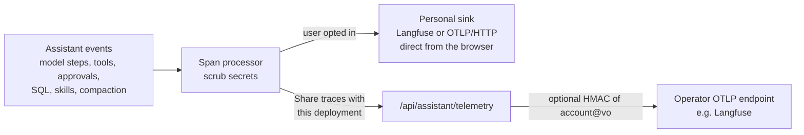

# Telemetry: OpenTelemetry to Langfuse, opt-in

  
<strong>One trace per turn</strong>, GenAI semantic conventions; Langfuse session = conversation, user = account@vo

  
<strong>Content level</strong>: metadata (default) or full, capped by <code>ASSISTANT_TELEMETRY_CONTENT_CAP</code> and read per event

  
<strong>Scrubbed before truncation</strong>: provider and Langfuse keys, Bearer and Basic values, Rucio tokens, JWTs, private keys, every key in settings

  Operator side: <code>ASSISTANT_TELEMETRY_OTLP_ENDPOINT</code>, <code>_OTLP_HEADERS</code>, <code>_HASH_USER</code> with a 16+ character <code>_USER_SALT</code>. The relay needs a session, caps bodies at 1 MiB, never forwards client headers, never logs bodies. The SDK loads only when a sink is active.

<!--
Off by default, twice: the user's own sink needs its toggle, and the deployment sink needs the user to tick "Share traces with this deployment".
Spans follow the OpenTelemetry GenAI conventions and map onto Langfuse sessions and users.
Content level is metadata by default: timings, tokens, tool names, status. Full content includes prompts and results, and the operator can cap it.
With hashing on, the relay replaces account at VO with an HMAC using a server-only salt.
Without any sink, the same events still drive the in-app activity timeline.
-->

---
layout: default
---

# The Telemetry tab

  

- **This deployment**: "Share traces with this deployment", off until the user ticks it; the account is replaced by a salted hash
- **Your trace sink**: Langfuse or an OTLP endpoint, with a plain-text key warning and **Test export**
- **Content level**: here the operator caps it, so **Full content (operator limit)** is disabled

<!--
This story shows an operator that enables hashing and caps content at metadata.
The user has their own Langfuse project configured; Test export checks CORS, credentials and the path before anything is sent.
-->
