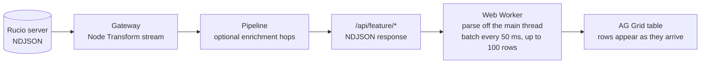

# One streaming interface for every list

  
First rows fast

  
You see results while Rucio is still sending them; pause or stop any time

  
One code path

  
16 tables use it: DIDs, rules, RSEs, subscriptions, approvals, replicas, accounts, rule locks

  
New this year

  
Rows and progress in one stream: "All" DID search runs containers and datasets together, files only as a fallback

  Same tables everywhere: filter, multi-select filters on every enum column, sort, resize, shareable URL filters.

<!--
Every list in the WebUI goes through the same path. Rucio streams NDJSON; the WebUI server transforms and optionally enriches each row; the browser parses in a Web Worker and pushes batches into the grid.
So a new list page is mostly a gateway endpoint and a column definition.
New this year: a stream can carry progress records next to rows. That is how "All" search shows "searching datasets..." in the table while rows already arrive.
-->
